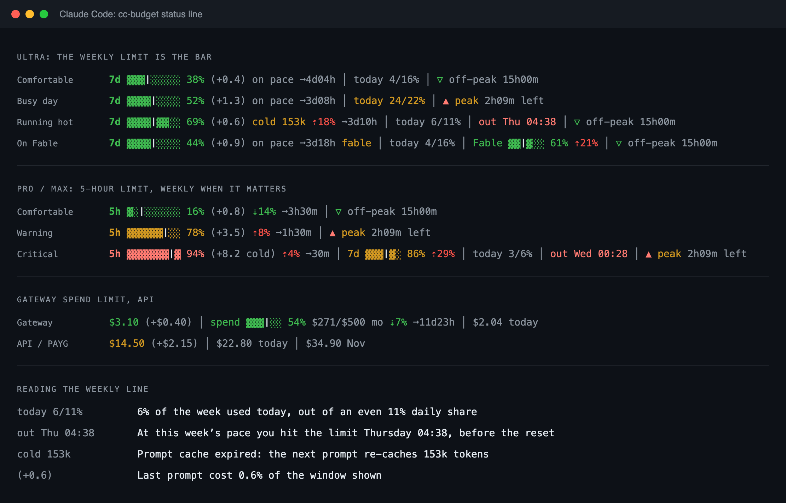
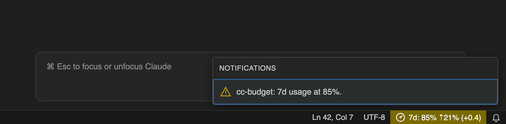

# cc-budget

Know your Claude Code budget before you hit the wall.


cc-budget adds budget pacing to Claude Code's status line: where your usage should be by now, what each prompt cost, when you will run out at the current rate, and a warning before you cross a threshold. It works on every plan:

| Plan | Main bar | Also shown |
|---|---|---|
| Pro, Max | 5-hour limit | Weekly limit once it matters, Fable cap on Max |
| Ultra (verified) | Weekly limit (Ultra has no 5-hour limit) | Today's share of the week, run-out time, Fable cap |
| Claude gateway | Your spend limit in dollars | Session cost, today's spend |
| API / Enterprise PAYG | Session cost in dollars | Today and month totals |

The plan is detected from what Claude Code reports, so there is nothing to configure. An Ultra account that still has a temporary 5-hour limit (new accounts before verification) gets the 5-hour bar until the limit goes away.

## Features

**Pacing.** A white `│` marker in the progress bar shows where usage would be if you spread it evenly across the window. `⇡`/`⇣` says how far ahead or behind that you are.

```
▓▓▓│░░░░░ 24%  ⇣6%     6% under pace
▓▓▓▓▓▓│░░ 78%  ⇡12%    12% over pace
▓▓▓▓│░░░░ 50%  on pace
```

**Per-prompt cost.** `(+1.2)` is what the last prompt cost as a share of the main window. Claude Code reports usage in whole percent, which is too coarse for a single prompt against the weekly limit, so cc-budget learns how many dollars of list-price usage move your weekly limit by 1% and converts each prompt's cost with that ratio. Until it has seen the weekly number move twice, the delta is the raw whole-percent change.

**Weekly planning.** When the weekly limit is on screen:

```
7d ▓▓▓▓│▓▓░░ 69% (+0.4) ⇡18% ➞3d10h │ today 4/9% │ out Mon 23:50 │ ▽ off-peak 3h34m
```

- `today 4/9%`: 4% of the week used since midnight, out of an even daily share of 9% (what is left divided by the days to reset, fixed at the start of the day). Yellow above the share, red above 1.5 times it.
- `out Mon 23:50`: at this week's average rate you reach 100% on Monday at 23:50, before the reset. Hidden when you make it to the reset. The hook also warns once per week when this happens past 50% usage.

**Fable.** Fable 5 and 5.1 have their own weekly cap (the "Fable" row in `/usage`). On Max and Ultra it allows up to half of the weekly limit; past it, Fable bills usage credits. On Pro, Fable uses credits from the first request. cc-budget shows a yellow `fable` tag while Fable is the active model, renders the cap as its own bar, and warns at the weekly thresholds that you are close to paying in credits:

```
5h ▓▓▓│░░░░░ 34% (+1.2) ⇣5% ➞2h10m fable │ Fable ▓▓│░░░ 41% ⇡8% │ ▽ off-peak 3h15m
```

The Fable bar appears while Fable is active or once its cap passes 50%. Claude Code leaves the per-model data out when it is answering from cached usage, so cc-budget keeps the last value it saw until that window resets.

**Cost tags.** `fast` (fast mode) and `xhigh` / `max` (effort level) appear next to the bar because they make every prompt more expensive.

**Prompt cache.** Uses the `prompt_cache` data Claude Code sends (2.1.251+):

- `(+8.2 cold)`: the last prompt rebuilt the prompt cache, which is why it cost more.
- `cold 153k`: the cache has expired, so your next prompt re-caches 153k tokens.
- `cache 8m`: the cache expires in 8 minutes.

The last two need `statusLine.refreshInterval` so the line updates while you are idle. `install.sh` sets it to 30 seconds. Older Claude Code versions fall back to a 5-minute idle check.

**Peak/off-peak.** Anthropic limits usage harder during peak hours (5-11 AM PT, weekdays). cc-budget shows a countdown in any timezone: `▲ peak 3h22m left` or `▽ off-peak 21h05m`.

**Threshold warnings.** At 90% and 95% of the 5-hour limit and 80% and 90% of the weekly limit, the hook adds a short note before your prompt, once per window. It also flags a single expensive prompt (5% of the 5-hour limit, or 1% of the week when there is no 5-hour limit) and a projected weekly run-out.

**Progressive display.** At low usage the line stays short. The weekly bar, run-out time and peak details appear as usage climbs.

```
Comfortable:  5h ▓░│░░░░░ 16% ⇣14% ➞3h29m │ ▽ off-peak 21h05m
Warning:      5h ▓▓▓▓▓▓│░ 78% ⇡8%  ➞1h29m │ ▲ peak 3h09m left
Critical:     5h ▓▓▓▓▓▓▓│ 94% ⇡4%  ➞29m   │ 7d ▓▓▓│░ 86% ⇡29% │ out Mon 01:02 │ ▲ peak 3h09m left
```



## Claude gateway, Enterprise, API

Behind a Claude apps gateway that sets a spend limit, the limit becomes the bar, with its dollars and period:

```
$3.10 (+$0.40) │ spend ▓▓▓│░░ 54% $271/$500 mo ⇣7% ➞11d23h │ $2.04 today
```

On API keys or Enterprise PAYG without a gateway limit, cc-budget tracks dollars:

```
$0.84 (+$0.32) │ $2.04 today │ $2.04 Mar
$14.50 (+$2.15) │ $22.80 today │ $34.90 Mar
```

- Session cost: running total for the session, green/yellow/red at $0-5/$5-20/$20+ (configurable)
- `(+$X.XX)`: cost of the last prompt
- Daily and monthly totals across sessions, kept across `/clear`

Spend history lives in `~/.claude/cc-budget/state.json`, keyed by session and pruned after 31 days. Subscription sessions are left out, because their dollar figures are list-price estimates you don't pay. Costs are list price; set `enterprise_discount` for a negotiated discount. Gateway amounts come from the gateway's own meter and are never discounted.

## Install

```bash
git clone https://github.com/boyand/cc-budget /tmp/cc-budget
cd /tmp/cc-budget && ./install.sh
```

Or manually:

```bash
mkdir -p ~/.claude/hooks/cc-budget/lib
cp statusline.cjs hook.cjs ~/.claude/hooks/cc-budget/
cp lib/*.cjs ~/.claude/hooks/cc-budget/lib/

mkdir -p ~/.config/cc-budget
cp config.example.json ~/.config/cc-budget/config.json
```

Then add to `~/.claude/settings.json`:

```json
{
  "statusLine": {
    "type": "command",
    "command": "node ~/.claude/hooks/cc-budget/statusline.cjs",
    "refreshInterval": 30
  },
  "hooks": {
    "UserPromptSubmit": [
      {
        "matcher": "",
        "hooks": [{
          "type": "command",
          "command": "node ~/.claude/hooks/cc-budget/hook.cjs",
          "timeout": 5000
        }]
      }
    ]
  }
}
```

## Requirements

- Claude Code v2.1.80+ for rate limits; v2.1.251+ for the prompt-cache markers
- Any plan: Pro, Max, Ultra, Team, Enterprise, gateway, or API
- Node.js (ships with Claude Code, no other dependencies)

## Configuration

Edit `~/.config/cc-budget/config.json`:

```jsonc
{
  "thresholds": {
    "warn_5h": 90,            // 5-hour limit warning
    "critical_5h": 95,
    "warn_7d": 80,            // weekly limit warning (also the Fable cap)
    "critical_7d": 90,
    "warn_cost_usd": 5,       // dollar plans: session cost turns yellow
    "critical_cost_usd": 20,  // dollar plans: session cost turns red
    "expensive_delta": 5,     // flag one prompt above this % of the 5h limit
    "expensive_delta_7d": 1   // same, % of the week, when there is no 5h limit
  },
  "peak": {
    "start_hour": 5,          // Anthropic peak start (Pacific Time)
    "end_hour": 11,
    "timezone": "America/Los_Angeles",
    "weekdays_only": true
  },
  "show_delta": true,         // show (+N.N) per-prompt cost
  "show_7d": "auto",          // "auto" | "always" | "never" (when 5h is the main bar)
  "enterprise_discount": 0    // your discount %, e.g. 20 for 20% off list price
}
```

Defaults are built in, so the config file is optional.

## Visual legend

Run this to see a full annotated guide to the status line:

```bash
node ~/.claude/hooks/cc-budget/statusline.cjs --legend
```

## ccstatusline integration

Already using [ccstatusline](https://github.com/sirmalloc/ccstatusline)? Add cc-budget as a Custom Command widget and keep your statusline:

```yaml
widgets:
  - type: customCommand
    command: "node ~/.claude/hooks/cc-budget/statusline.cjs --widget"
    timeout: 1000
```

Widget mode outputs only what ccstatusline doesn't have: pacing, per-prompt delta, run-out time, cost tags, and the peak indicator. The hook warnings work regardless of which statusline you use.

## How it works

1. Claude Code pipes JSON (`rate_limits`, `cost`, `prompt_cache`, model) to the status line command on every assistant message and every `refreshInterval`
2. cc-budget writes state atomically to `~/.claude/cc-budget/state.json` (SIGTERM-safe)
3. Computes the per-prompt delta, pacing target, run-out projection, and peak/off-peak status
4. Outputs a progressive display that adapts to urgency
5. The hook reads state on each prompt and warns once per threshold crossing per window

Zero external dependencies. Zero API calls. All data comes from Claude Code's built-in status line JSON.

## VS Code Extension

A companion VS Code extension shows cc-budget data in the editor status bar, so you can see it without switching to the Claude Code terminal.



**What you see:**

```
$(dashboard) 5h: 55% ⇣3% (+1.2) | 7d: 82% | Fable: 41% ▲pk
$(dashboard) 7d: 69% ⇡18% (+0.4)                              (Ultra)
$(credit-card) $3.10 | limit 54%                               (gateway)
```

- 5h and 7d usage percentages; on Ultra the weekly limit is the main segment
- Per-model weekly limits (e.g. Fable's separate cap), with notifications at the 7d thresholds
- Pace indicator (⇡ over / ⇣ under)
- Per-prompt delta cost
- Peak hours indicator
- Background color: yellow at 70%, red at 90% (uses worst of 5h/7d/model windows)
- Click for a detailed modal breakdown
- Native VS Code notifications at threshold crossings

**Install:**

First, install the CLI hooks (if you haven't already):

```bash
git clone https://github.com/boyand/cc-budget /tmp/cc-budget
cd /tmp/cc-budget && ./install.sh
```

Then build and install the VS Code extension:

```bash
cd /tmp/cc-budget/vscode-extension
npx @vscode/vsce package --no-dependencies
code --install-extension cc-budget-0.3.0.vsix
```

Reload VS Code (Cmd+Shift+P → "Developer: Reload Window") and the status bar item appears at the bottom right.

**Development:**

Open `vscode-extension/` in VS Code and press F5 to launch an Extension Development Host.

The extension reads the same `~/.claude/cc-budget/state.json` and `~/.config/cc-budget/config.json` as the CLI and needs no extra configuration.

## Uninstall

```bash
rm -rf ~/.claude/hooks/cc-budget ~/.claude/cc-budget ~/.config/cc-budget
```

Then remove the `statusLine` and `UserPromptSubmit` entries from `~/.claude/settings.json`.

## License

MIT
